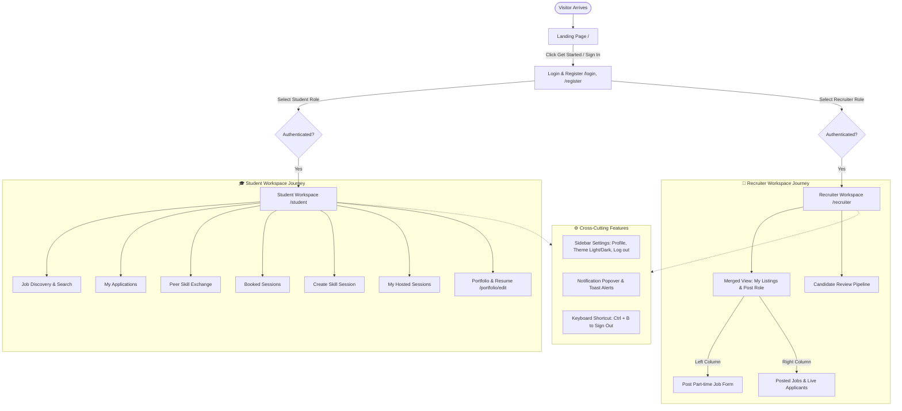
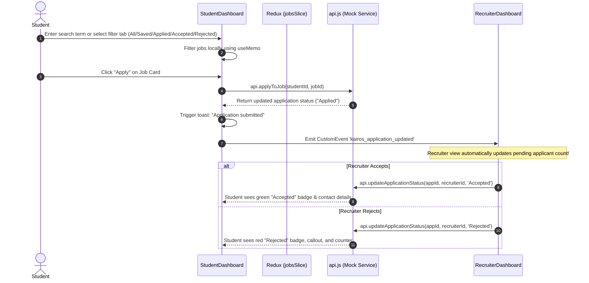
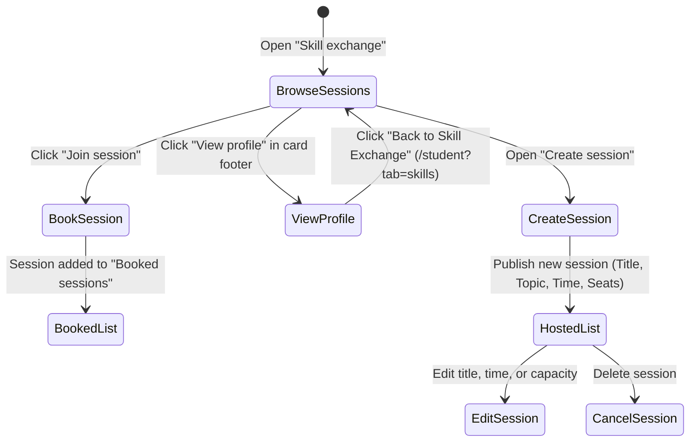
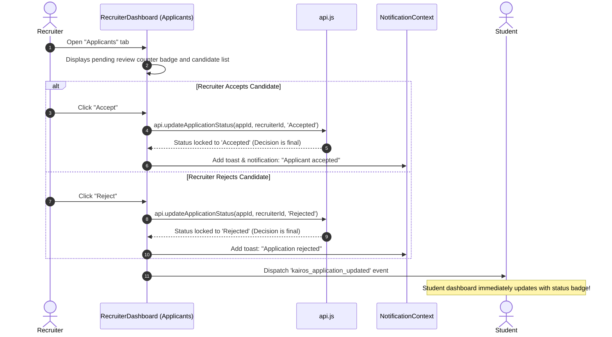

# Kairos - Application User & Data Flow Guide

This document outlines the complete user journeys, data flow, status lifecycles, and cross-cutting event mechanisms across the Kairos platform.

---

## 1. High-Level System Flow Diagram



---

## 2. Authentication & Authorization Flow

1. **Visitor Landing**:
   - The user visits the app root (`/#/`).
   - The landing page showcases the value proposition, live stats, student peer exchange, and dual entry points.

2. **Login / Registration**:
   - Route: `/#/login` or `/#/register`.
   - Dual-role switch: `Student` or `Recruiter`.
   - **Demo Accounts Button**: Quick-fill dropdown at the top of the login screen allows instant evaluation without typing credentials.
   - Upon successful credentials verification in `api.login()`, the user object and authentication token are saved in `AuthContext` (persisted in `localStorage`).

3. **Role-Based Redirection (`ProtectedRoute.jsx`)**:
   - Checks if user is authenticated: if not, redirects to `/login`.
   - Checks if user has the required role (`allowedRole`):
     - `Student` trying to access `/recruiter` is redirected to `/student`.
     - `Recruiter` trying to access `/student` is redirected to `/recruiter`.

---

## 3. Student Workflow Details

### A. Job Discovery & Application Flow


1. **Browse Roles**: Students filter through campus and hybrid jobs by keyword, category, or status tab (`All`, `Saved`, `Applied`, `Accepted`, `Rejected`).
2. **Detailed View**: Clicking a job navigates to `/#/jobs/:jobId` with full description, recruiter company details, and compensation. If rejected, the button is disabled with a notice that the application was declined.
3. **Save for Later**: Clicking the bookmark icon toggles saved jobs instantly.
4. **My Applications Tab**: Tracks all submitted roles, displaying color-coded status badges:
   - `Applied / Under Review` (Gold badge)
   - `Accepted` (Green badge with employer contact instructions)
   - `Rejected` (Red badge with respectful feedback notice)
   - `Saved` (Blue badge)

### B. Peer Skill Exchange Flow


1. **Browse Sessions**: Students discover micro-learning workshops hosted by fellow students (e.g., React Hooks, Figma UI, Interview Prep).
2. **View Host Profile**: Every session card features a dedicated **"View profile"** button in its footer action row. Navigating to the student teacher's profile preserves the referrer state (`from: 'skills'`), allowing the back button to return directly to the Skill Exchange tab rather than defaulting to job listings.
3. **Book & Cancel Seats (Real-Time Counter Adjustment)**:
   - One-click booking immediately decreases the remaining seats for that session by 1. Sessions with 0 seats remaining are disabled and marked "Full".
   - Cancelling a booking releases the seat and increments the session's available seats back by 1.
4. **Booked Sessions & Cancellation Lock**:
   - Students who applied/booked can access the session in "Booked sessions".
   - If the host has not yet provided a meeting link, the card clearly shows: `Link will be given to you soon.` and allows cancellation.
   - Once the host provides the meeting link, a **"Join meeting"** button appears, and **cancellation is strictly locked** (`Cancellation locked — meeting link provided`) so confirmed attendees cannot cancel once the session is finalized.
5. **Host a Session & Provide Meeting Link**:
   - Students can host custom workshops.
   - In "My sessions", the host has a **"Provide link"** button to enter their Google Meet, Zoom, or Teams URL.
   - Pushing the link sends an instant push notification to all booked learners and unlocks the meeting room exclusively for enrolled students.
6. **Manage Sessions**: Edit details or remove sessions anytime.

### C. Student Portfolio & Resume Flow
- Accessible from sidebar: **Edit portfolio** (`/#/portfolio/edit`) and **View portfolio** (`/#/profile`).
- Clean, focused interface without distracting tips.
- Students can update their Bio, add taggable Skills, link GitHub/Live projects, and upload a PDF resume file.
- When applying to jobs, recruiters see the student's name, college, course, bio, and resume link.

---

## 4. Recruiter Workflow Details

### A. Unified Job Posting & Management Flow
```mermaid
flowchart LR
    subgraph RecruiterLayout ["Recruiter Workspace (2-Column Grid)"]
        direction TB
        Form["Left: Post a Job Form
        - Title & Arrangement
        - Location & Hours
        - Pay Rate & Vacancies
        - Role Description"]
        
        Listings["Right: Posted Jobs Panel
        - Active filter toggle
        - Pause / Activate button
        - Remove listing button
        - Clean Applicant counts"]
    end

    Form -->|Click 'Publish Job'| Action[dispatch(createJob)]
    Action -->|Instant Live Update| Listings
```

1. **Sidebar Navigation**:
   - **My listings**: Displays the merged two-column layout with posted job listings and fast job creation form.
   - **Applicants**: Dedicated candidate review pipeline with live **pending reviews counter badge**.
2. **Publishing a Role**:
   - Recruiter completes the job creation form on the left.
   - On submit, job is validated and added to the store via Redux `createJob`.
   - A success notification is shown, and the job appears instantly in the right-hand listings panel without page reload.
3. **Managing Postings**:
   - **Pause/Activate**: Toggles job status so students can or cannot see it in search.
   - **Remove**: Deletes the posting and cleans up related applications.

### B. Candidate Review Pipeline Flow


- **Final, Irreversible Decisions**: Once an application is marked **Accepted** or **Rejected**, the decision is permanent. Action buttons disappear to prevent accidental status toggling.
- **Dedicated Pending Reviews Count**: Pending reviews are shown strictly on the **Applicants** tab banner and the **Applicants** sidebar nav badge, keeping "My listings" clean and focused.
- Quick `mailto:` button allows direct email communication with accepted students.

---

## 5. Real-Time Cross-Tab & Event Flow

The app maintains synchronized state across multiple browser tabs and components without a heavy websocket server:
- **Custom Event Bus**: `window.dispatchEvent(new CustomEvent('kairos_application_updated'))` fires whenever an application status changes or a new job is posted.
- **Storage Sync**: `window.addEventListener('storage', ...)` and `localStorage` persistence sync session and application states (`kairos_applications`) if the recruiter and student workspaces are opened in different tabs or windows.

---

## 6. Theme & Settings Flow

1. **Sidebar Settings Trigger**:
   - Available in both Student and Recruiter sidebars at the bottom.
   - Clicking opens the embedded settings drawer with an **Account** link.
2. **Appearance Switch**:
   - Clicking **Light** or **Dark** updates `ThemeContext`.
   - Adds/removes the `.dark-theme` class on `document.body` and saves preference to `localStorage`.
   - All CSS variables dynamically adapt seamlessly.
3. **Sign Out**:
   - Click "Log out" or press <kbd>Ctrl</kbd> + <kbd>B</kbd> keyboard shortcut.
   - Clears credentials from `AuthContext` and redirects to `/login`.
