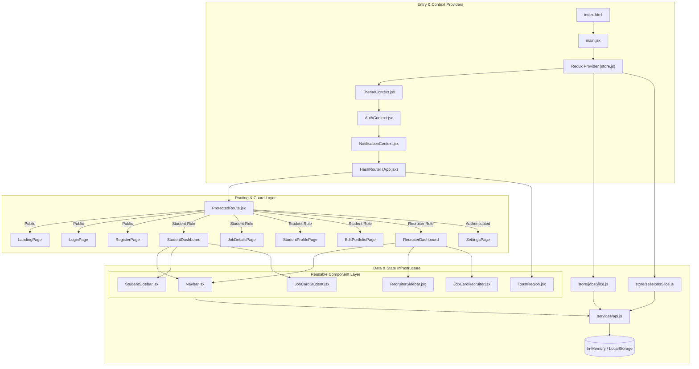
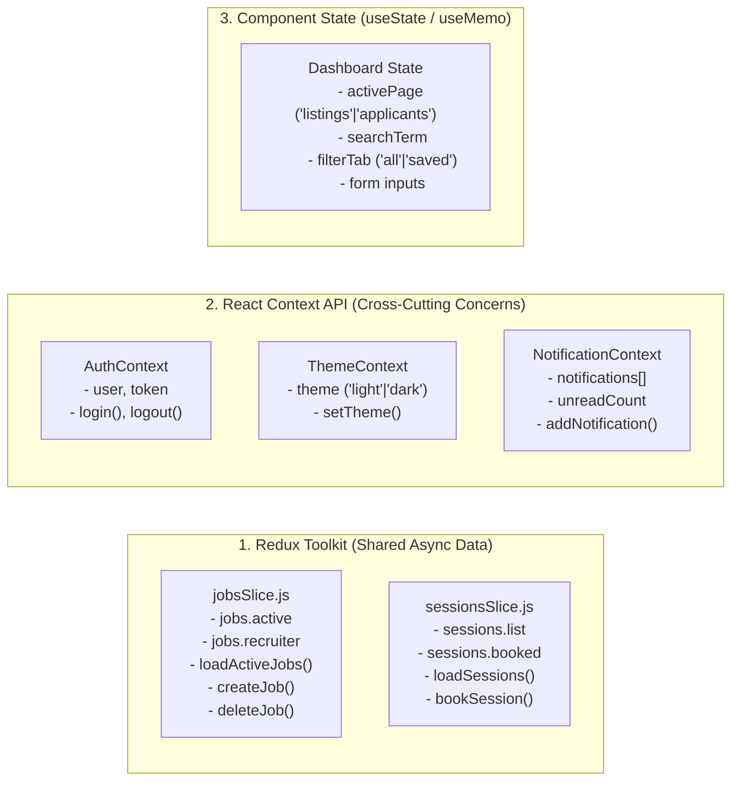
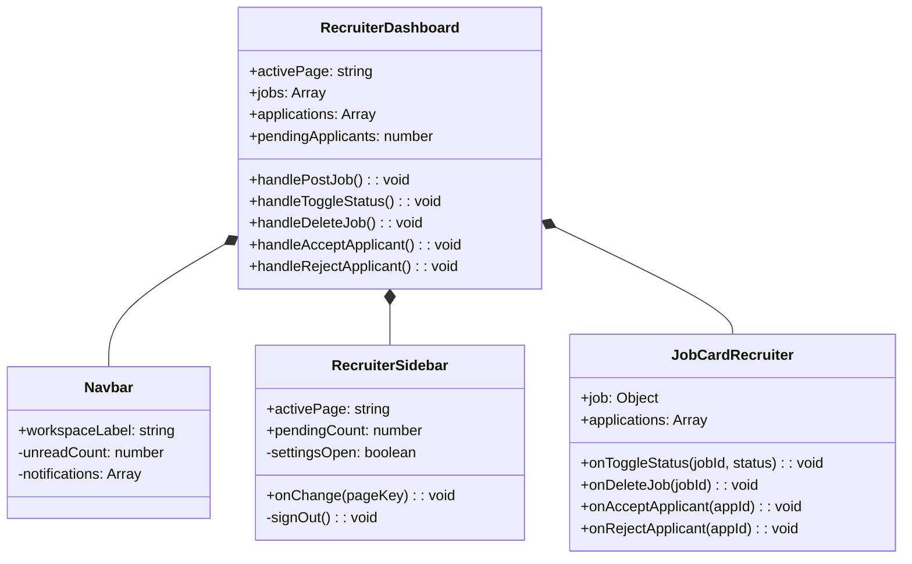

# How the Kairos Project Connects: Architecture & Component Wiring

This document explains the technical architecture, component tree, provider hierarchy, state management layers, and communication mechanisms of the Kairos frontend application.

---

## 1. Architectural Overview Diagram



---

## 2. Bootstrapping & Provider Hierarchy

The application initializes in [`main.jsx`](file:///c:/Users/yashx/OneDrive/Desktop/FrondEnd%20FINAL/frontend/src/main.jsx) and wraps the component tree in a layered provider hierarchy:

```jsx
// main.jsx
<StrictMode>
  <Provider store={store}>       {/* Redux Toolkit store */}
    <App />
  </Provider>
</StrictMode>
```

Within [`App.jsx`](file:///c:/Users/yashx/OneDrive/Desktop/FrondEnd%20FINAL/frontend/src/App.jsx), providers are nested to supply global cross-cutting state:

```jsx
// App.jsx
<ThemeProvider>                 {/* 1. Theme State (light/dark mode toggle) */}
  <AuthProvider>                {/* 2. Authentication State (user session, login/logout) */}
    <NotificationProvider>      {/* 3. Notification State (toasts, unread popover items) */}
      <HashRouter>              {/* 4. Client-side Routing */}
        <Routes> ... </Routes>
        <ToastRegion />         {/* Global floating toast notification container */}
      </HashRouter>
    </NotificationProvider>
  </AuthProvider>
</ThemeProvider>
```

### Why this order matters:
1. **`Provider (Redux)`**: Sits at the top so any page, component, or context consumer can dispatch actions.
2. **`ThemeProvider`**: Injects theme class into `<body>` immediately upon mount, preventing flash of unstyled theme.
3. **`AuthProvider`**: Manages user identity and permissions consumed by `ProtectedRoute` and route elements.
4. **`NotificationProvider`**: Injects toast dispatchers used by action handlers (e.g., job applied, status changed).
5. **`HashRouter`**: Enables URL hashing (e.g., `/#/student`), eliminating server rewrite requirements for single-page applications.

---

## 3. Route Guard & Role-Based Security

Protected pages are wrapped with [`ProtectedRoute.jsx`](file:///c:/Users/yashx/OneDrive/Desktop/FrondEnd%20FINAL/frontend/src/components/ProtectedRoute.jsx):

```jsx
<Route
  path="/recruiter"
  element={
    <ProtectedRoute allowedRole="Recruiter">
      <RecruiterDashboard />
    </ProtectedRoute>
  }
/>
```

### How `ProtectedRoute` operates:
- Reads `user` from `useAuth()`.
- **Not logged in**: Redirects directly to `/#/login`.
- **Logged in with wrong role**: Automatically redirects to their authorized workspace (e.g., a student visiting `/recruiter` is redirected to `/student`).
- **Authorized**: Renders the target child component.

---

## 4. State Management Architecture

Kairos uses a balanced three-tier state management design:



| Layer | Technology | Responsibilities |
| :--- | :--- | :--- |
| **Shared Async Data** | **Redux Toolkit** | Asynchronous entity actions (`createAsyncThunk`), shared job listings, skill sessions. |
| **Cross-Cutting UI State** | **React Context** | User session (`AuthContext`), Appearance theme (`ThemeContext`), In-app alerts (`NotificationContext`). |
| **View & Filter State** | **React `useState` / `useMemo`** | Current sidebar view tab, search input query, active jobs toggle, multi-field form drafts. |

---

## 5. View Swapping vs Route Navigation

The dashboards use a hybrid navigation strategy:

### A. Sub-View Switching via Sidebar (`activePage`)
Instead of mounting full page reloads, [`StudentDashboard.jsx`](file:///c:/Users/yashx/OneDrive/Desktop/FrondEnd%20FINAL/frontend/src/pages/StudentDashboard.jsx) and [`RecruiterDashboard.jsx`](file:///c:/Users/yashx/OneDrive/Desktop/FrondEnd%20FINAL/frontend/src/pages/RecruiterDashboard.jsx) utilize state-driven view swapping:

```jsx
// RecruiterDashboard.jsx
const pageMap = {
  listings: ListingsAndPostView, // Merged 2-column view
  'post-job': ListingsAndPostView,
  applicants: ApplicantsView,     // Candidate pipeline
};

return (
  <div className="recruiter-workspace-layout">
    <RecruiterSidebar activePage={activePage} onChange={setActivePage} />
    {pageMap[activePage] || ListingsAndPostView}
  </div>
);
```
- **Benefits**: Instant zero-latency tab switching, preserves scroll state, avoids redundant data fetches.

### B. Dedicated Full-Page Routes
For standalone deep-linked tasks, dedicated router routes are used:
- `/#/jobs/:jobId`: Detailed job view.
- `/#/settings`: Account and profile editor.
- `/#/portfolio/edit`: Comprehensive portfolio and resume builder.
- `/#/profile`: Student's personal portfolio showcase.
- `/#/students/:studentId`: Public view of other students' portfolios (e.g. peer tutors from Skill Exchange or candidates for recruiters). Supports state (`{ from: 'skills' }`) and query params (`?tab=skills`) to preserve back navigation.

---

## 6. Service & Data Mock Layer (`api.js`)

All asynchronous business logic connects through [`frontend/src/services/api.js`](file:///c:/Users/yashx/OneDrive/Desktop/FrondEnd%20FINAL/frontend/src/services/api.js).

### Features:
1. **Async Simulation (`asyncWrap`)**: Returns Promises with realistic micro-delays (40ms) to ensure true asynchronous component lifecycles (loading spinners, disabled states).
2. **Dual-Role Persistent Store**:
   - Seeded initial state for recruiters, jobs, student portfolios, applications, and skill sessions.
   - Applications are persisted in `localStorage` under `kairos_applications` so that status changes (`Applied`, `Accepted`, `Rejected`) endure across browser refreshes and tab transitions.
3. **Decision Finality Enforcement**:
   - `updateApplicationStatus` prevents overwriting or toggling applications that are already in an `Accepted` or `Rejected` state, guaranteeing strict decision finality.
4. **Session Seat Management & Cancellation Locking**:
   - Booking a skill session decrements available seats in real time and guards against overbooking.
   - Cancelling increments the available seats back by 1.
   - If a meeting link has been provided by the host, cancellation is strictly locked and throws an error if attempted.
5. **Cross-Component Event Bus**:
   - Updates dispatch `window.dispatchEvent(new CustomEvent('kairos_application_updated'))` and `new Event('kairos_sessions_updated')`.
   - Both recruiter and student components listen to these events to keep applicants, review counts, session seats, and meeting links instantly synchronized without a WebSocket backend.

---

## 7. Component Map & Prop Contracts



---

## 8. Styling Architecture (`index.css`)

All styling is managed through unified Vanilla CSS design tokens in [`index.css`](file:///c:/Users/yashx/OneDrive/Desktop/FrondEnd%20FINAL/frontend/src/index.css):

- **Tokens (`:root`)**: `--green`, `--light-green`, `--surface`, `--card-bg`, `--ink`, `--muted`, `--line`.
- **Dark Theme (`.dark-theme`)**: Re-assigns CSS tokens at the root level, so components instantly adapt without CSS re-writing.
- **Layout Grids**:
  - `.student-workspace-layout`: `225px` sidebar + fluid content area.
  - `.recruiter-workspace-layout`: `230px` sidebar + fluid content area.
  - `.dashboard-grid`: `minmax(340px, 0.9fr) 1.1fr` two-column layout for post form + listings. Responsive breakpoint at `1120px` to stack columns on smaller screens.
